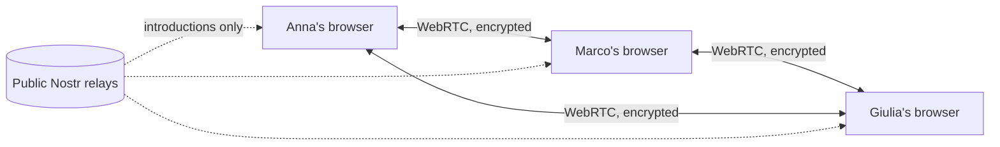

<div align="center">


# Meshboard

**The team whiteboard that needs nothing to start.**

Sticky notes, shapes, frames, connectors and emoji reactions in real time.<br />
Send a link and work together: no accounts, no backend, nothing to pay for.<br />
When your team needs more, the same app runs on your own server.

[**Open Meshboard →**](https://andrianleah.github.io/meshboard/) &nbsp;·&nbsp; [Why](#why-meshboard) &nbsp;·&nbsp; [How it works](#how-it-works) &nbsp;·&nbsp; [Host your own](#host-your-own-in-5-minutes) &nbsp;·&nbsp; [Self-hosting](docs/self-hosting.md)

[](https://github.com/AndrianLeah/meshboard/actions/workflows/ci.yml)
[](https://github.com/AndrianLeah/meshboard/actions/workflows/deploy.yml)
[](LICENSE)
[](#how-it-works)
[](#try-it)

</div>

<br />


## Why Meshboard

Team rituals happen on a whiteboard: the sprint retro, the brainstorm, the planning session, the
workshop. They need a board everyone can open in a second, notes that are quick to write, a way to
react and vote, and nothing standing in the way. Meshboard does that one job, and it's built so
that starting costs nothing and growing doesn't mean changing tools.

### What it's good at

- **Nothing to start with.** Open the page, create a board, send the link: you're working together.
  No accounts, no sign-up, no backend, nothing to install or pay for. On the public site the content
  only ever lives in the participants' browsers.
- **Grows without changing tools.** The same app becomes the self-hosted one when it finds a server:
  boards that are there for whoever opens them, sign-in, owners, editors and viewers, a dashboard of
  every board you can open. One container, SQLite by default. People keep the board they know.
- **Fits into a company, not next to it.** On your own server Meshboard has no accounts of its own:
  people sign in with what the organisation already uses (OpenID Connect, an SSO gateway, or its
  own service), and it keeps its data in a database of its own. Sign-in is the only thing it needs
  from your systems.
- **Small enough to read.** About 8,400 lines of strict TypeScript for the app and 3,200 for the
  server, with 3,000 lines of tests: a security team can review all of it before approving it.
- **Made for team rituals.** Sticky notes that fit their text, emoji reactions instead of fixed
  votes, frames that carry their content, connectors, live cursors, the shortcuts people already
  know, and an undo that only touches your own changes.
- **Works where you are.** In the browser on desktop and phone, installable as an app, and usable
  offline: changes merge when you're back.

### Good fits

- Sprint retrospectives, stand-ups and planning sessions.
- Brainstorms, workshops and design sprints, in the room or remote.
- A quick shared sketch during a call, without asking anyone to sign up.
- An internal whiteboard for a company that wants its data on its own servers and its own sign-in.

### Not the right tool

- **A knowledge base.** Meshboard is a whiteboard only: no documents, wikis, databases or tasks to
  link boards to.
- **Precise diagrams.** It has shapes and connectors for thinking together, not a diagramming engine
  with auto-layout, standard notations or exact measurements.
- **Big audiences.** It's made for teams. Peer to peer connects every browser to every other one,
  so dozens of people on one board is the limit, not hundreds.
- **Long-term storage on the public site.** There a board lives only in the browsers that had it:
  export it to keep it, or run your own server, where boards are kept.
- **Every network, peer to peer.** Some mobile and office networks block direct connections; a relay
  or your own server fixes that (see [below](#optional-a-relay-for-strict-networks)).
- **Guests from outside the organisation** on a self-hosted server: everyone signs in, and there are
  no guest links yet.
- **Storing files.** Images on a board are addresses: Meshboard never keeps the files. Pictures
  are uploaded to storage you already have, or added by their address; attachments such as PDFs
  aren't supported.

## Features

| Feature | What it does |
| --- | --- |
| 🗒️ **Sticky notes that fit their text** | Text is centred and sized to fit the note. Double-click anywhere for a new note, or use the **+** around a selected one to add the next. |
| 🔷 **Shapes, text, frames and a pen** | Rectangles, ovals, triangles, diamonds, text boxes and freehand strokes in eight colours. Frames are titled sheets that carry their content when they move. |
| 🖼️ **Images** | Paste an image's address, drop a picture or use the image button. Meshboard keeps only the address: files go to an upload endpoint you choose ([how](docs/self-hosting.md#images)). |
| ↗️ **Connectors** | Drag from the dots around any item to another one: the line follows both. Arrow ends and dashed lines from the context bar. |
| 🎉 **Reactions** | Any emoji on any note, from a searchable picker that remembers your favourites. Hover a chip to see who reacted. |
| 🧭 **Familiar controls** | Context bar above the selection, right-click menu, smart guides, copy and paste, groups, locks and the shortcuts other whiteboards use (press <kbd>?</kbd>). |
| 🖱️ **Live presence** | See who's online and where their cursor is, in real time. |
| ↩️ **Personal undo** | Undo and redo only touch your own changes, never a teammate's. |
| 💾 **Import / export** | Save a board as JSON, add it to another board or start a new one from the file. |
| 📱 **Installable, works offline** | A PWA for desktop and mobile. Edit offline; changes merge when you're back. |
| 🔒 **Private by link** | The link is the key: the handshake is encrypted with a secret that only lives in the link. |

<table>
  <tr>
    <td width="62%" valign="top"></td>
    <td width="38%" valign="top"></td>
  </tr>
</table>

## How it works



- **The link is the room.** A new board gets a link like `…/meshboard/#<room>.<secret>`. The part
  after `#` never reaches the web server: the room id lets peers find each other, and the secret
  encrypts the handshake so nobody without the link can join.
- **Browsers connect directly.** [Trystero](https://github.com/dmotz/trystero) uses public
  [Nostr](https://nostr.com) relays only for introductions. After that, everything flows over
  encrypted WebRTC data channels, browser to browser.
- **Edits merge without conflicts.** The board is a [Yjs](https://yjs.dev) CRDT document: people
  can edit at the same time, and anyone who was offline catches up automatically on reconnect.
- **Every browser keeps a copy.** Boards are stored in IndexedDB, so you can close the tab and
  find your board again under *Recent boards*.

**On your own server** the same build finds a `config.json` and changes mode: browsers sync
through one WebSocket to the server, which keeps each board in its own database, checks who may
open and edit it, and makes viewers read-only. The design and the reasons behind it are in
[docs/design/self-hosted.md](docs/design/self-hosted.md).

## Try it

1. Open **[andrianleah.github.io/meshboard](https://andrianleah.github.io/meshboard/)**, type your
   name and create a board.
2. Click **Share** and send the link to your teammates.
3. Want a head start? Download [`examples/retro-sprint.json`](examples/retro-sprint.json) and pick
   **Open an exported file** on the home screen.

**Install it as an app:** in Chrome or Edge, use the install icon in the address bar (or *Install
as app* in the board menu). On iPhone, use *Share → Add to Home Screen*.

<p align="center">
  
</p>

## Host your own in 5 minutes

Meshboard is a static site: GitHub Pages is all it needs.

1. **Fork** this repository.
2. In your fork, open **Settings → Pages** and set **Source** to **GitHub Actions**.
3. Push to `main` (or run the *Deploy to GitHub Pages* workflow). Your copy is live at
   `https://<you>.github.io/meshboard/`.

### Optional: a relay for strict networks

Meshboard doesn't need one, and none is set by default, the public instance included. Browsers connect
directly through most home and office networks, but not all: mobile carriers put phones behind shared
NATs that two browsers often can't connect through, and some company firewalls do the same. Teammates
then find each other but the board never loads, and Meshboard says so. A **TURN** relay fixes it: it
passes the connection along when a direct one fails, and it can't read it (WebRTC encrypts the traffic
end to end).

Set the relay in your repository under **Settings → Secrets and variables → Actions → Variables**, then
deploy again. They're variables, not secrets, on purpose: the browser needs them, so they end up in the
public site anyway.

| Variable | Value |
| --- | --- |
| `TURN_CREDENTIALS_URL` | A URL answering with ICE servers, such as [Metered](https://www.metered.ca/tools/openrelay/)'s `https://<app>.metered.live/api/v1/turn/credentials?apiKey=<key>` (free tier: 20 GB a month, ports 80 and 443) |
| `TURN_URLS`, `TURN_USERNAME`, `TURN_CREDENTIAL` | Or fixed credentials, from a provider such as [ExpressTURN](https://www.expressturn.com) (free tier: 1,000 GB a month) or your own [coturn](https://github.com/coturn/coturn). Separate several URLs with commas |

Only connections that can't go direct use the relay, so a small free tier goes a long way.

### Optional: uploading images

Anyone can add an image by pasting its https address. To let people add picture files too, set
`UPLOAD_URL` (and the converter, `UPLOAD_URL_PATH`) to an upload endpoint you already have, as
repository variables like the relay's: see [Images](docs/self-hosting.md#images). Meshboard never
stores the files, only the addresses your endpoint answers with.

### With accounts: your own server

For a company that wants boards kept on its own server, sign-in with the accounts it already has
(OpenID Connect, an SSO gateway, or its own service) and owners, editors and viewers, Meshboard also
runs as one container with a database of its own:

```bash
docker run -p 8080:8080 -v meshboard:/data -e MESHBOARD_URL=http://localhost:8080 ghcr.io/andrianleah/meshboard
```

A board is then there for whoever opens it, even when nobody else is online, and the home screen
becomes a dashboard of every board you can open. Sign-in is the only thing it needs from your
systems. Everything about running it is in [docs/self-hosting.md](docs/self-hosting.md).

## Good to know

- **A name is not a login** (on the public site). Anyone with the link can join and pick any name.
  Share links only with the people who should be on the board, or run your own server with
  sign-in.
- **A board lives with the people who use it** (on the public site). When nobody has it open, it
  exists only in the browsers that had it. Use **Export** to keep a long-term copy, or run your own
  server.
- **Some networks block direct connections.** On mobile data and some office networks teammates
  may not connect; whoever hosts Meshboard can add a relay: see
  [Optional: a relay for strict networks](#optional-a-relay-for-strict-networks).
- **Made for teams, not crowds.** Every browser connects to every other one: perfect for a team,
  not for hundreds of people on the same board.

## Development

Written in strict TypeScript. Requires Node 22.18 or later (see `.nvmrc`): Node runs the TypeScript tests
directly, and Vite compiles the app.

```bash
npm install
npm run dev        # http://localhost:5173
npm run check      # lint, formatting, type check, unit tests with coverage thresholds
npm run test:e2e   # end-to-end tests on the production build, in Chromium
npm run build      # production build in dist/, service worker included
```

| Script | What it does |
| --- | --- |
| `npm test` | Unit tests (`node --test` on the `.ts` files): the model, sync over an in-memory room, actions, geometry, view maths, files, clipboard, keymap, emoji search; and the server over real HTTP and WebSockets |
| `npm run test:coverage` | The same, failing below 85% of lines, 80% of branches, 75% of functions |
| `npm run test:e2e` | [Playwright](https://playwright.dev) tests in [`e2e/`](e2e/): desktop, phone, and the self-hosted server. Run `npx playwright install chromium` once, or set `PLAYWRIGHT_CHANNEL=chrome` to use your installed Chrome |
| `npm run lint` · `npm run format` | ESLint and Prettier |
| `npm run typecheck` | Strict type checking of the app, the service worker, the tests, specs and configs, and the server (four tsconfigs) |
| `npm run tokens` | Regenerates `src/styles/tokens.css` from `mockup/tokens/variables.css` |
| `npm run favicon` | Renders `public/favicon.svg` into `public/favicon.ico` (16, 32 and 48 px), which Safari needs |
| `npm run server` | The self-hosted server ([`server/`](server/)) with the built app: see [docs/self-hosting.md](docs/self-hosting.md) |

Changes reach `main` only through pull requests, and every pull request runs `check`, the build and the
end-to-end tests ([CI](.github/workflows/ci.yml)); `main` deploys to GitHub Pages only after the same checks pass.
Dependabot opens one grouped pull request when a dependency or action needs a security fix.

To simulate two people on one machine, open the app on both `http://localhost:5173` and
`http://127.0.0.1:5173` (or in a private window): each one gets its own name and storage. The end-to-end tests
keep off the network, so peer-to-peer itself is covered by the unit tests, which sync stores through an
in-memory room.

The interface is built on a small design system: colours, spacing, radii and sizes are tokens exported
from the FigCraft mockup ([`mockup/`](mockup/)), and every control comes from the same primitives.

| Folder | What it holds |
| --- | --- |
| [`src/core/`](src/core/) | The board model on Yjs, item schema and migrations, geometry, clipboard and files (no DOM: tested in Node) |
| [`src/sync/`](src/sync/) | IndexedDB copy, peer-to-peer transport (Trystero), the self-hosted transport (Hocuspocus) and presence |
| [`src/board/`](src/board/) | The canvas: view (pan, zoom, wheel), renderers, overlay, one file per tool, and the actions the commands call |
| [`src/commands/`](src/commands/) | Every action by id, and the one shortcut table behind keys, tooltips and the shortcuts panel |
| [`src/ui/`](src/ui/) | Toolbar, context bar, menus, emoji picker; [`ui/ds/`](src/ui/ds/) is the design system's JavaScript side |
| [`src/styles/`](src/styles/) | Generated tokens, the design system ([`ds/`](src/styles/ds/)) and layout |
| [`src/pages/`](src/pages/), [`src/app/`](src/app/) | Home, dashboard and board screens; which mode this is (config.json), install prompt and offline service worker |
| [`src/hosted/`](src/hosted/) | The self-hosted server's API, for the dashboard and the share dialog |
| [`server/`](server/) | The self-hosted server: sign-in, access, the API, live sync and its own database |

<details>
<summary><strong>Export format</strong></summary>

```json
{
  "format": "meshboard",
  "version": 2,
  "title": "Sprint 42 retro",
  "users": { "<id>": "Anna" },
  "items": [
    { "id": "n1", "type": "note", "x": 0, "y": 0, "w": 220, "h": 220,
      "color": "yellow", "text": "Move the daily stand-up to 9:45",
      "author": "<id>", "reactions": { "🎉": { "<id>": 1795500000000 } } },
    { "id": "f1", "type": "frame", "x": -40, "y": -40, "w": 600, "h": 400,
      "color": "gray", "text": "Action items" },
    { "id": "a1", "type": "arrow", "from": "n1", "to": "n2",
      "x1": 0, "y1": 0, "x2": 0, "y2": 0, "color": "gray",
      "start": "none", "end": "arrow", "dash": false }
  ]
}
```

Item types are `note`, `rect`, `ellipse`, `triangle`, `diamond`, `text`, `frame`, `path` (pen
strokes) and `arrow`. Arrows store their end points (`x1, y1, x2, y2`) and, when attached, the ids
of the items they connect (`from`, `to`). Any item can carry `locked` and a `group` id. Reactions
map each emoji to who reacted and when. Version 1 files still open: their 👍 / 👎 votes become
reactions.

</details>

## Brand

The icon is three sticky notes woven into a ring: each one rests on a neighbour and tucks under
the other, so no note sits on top of the rest, just like the peers on a board. It was drawn in
VectorCraft; the source file and design notes are in [`branding/`](branding/).

## Contributing

Bug reports, ideas and pull requests are welcome. [CONTRIBUTING.md](CONTRIBUTING.md) covers the
setup, the scripts, where things live and the house rules, and everyone follows the
[Code of Conduct](CODE_OF_CONDUCT.md).

Found a security problem? Please don't open an issue: [SECURITY.md](SECURITY.md) explains how to
report it privately and what's in scope.

## License

[MIT](LICENSE)
