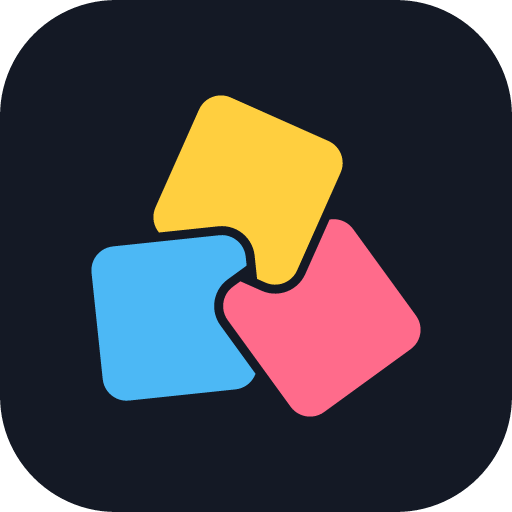
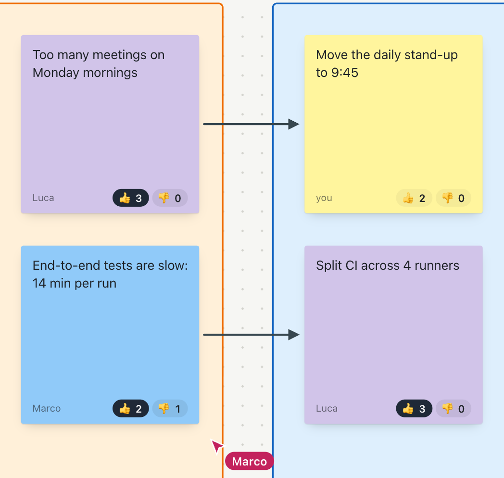
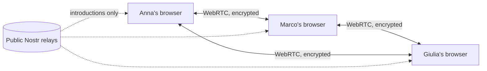

<div align="center">



# Meshboard

**The team whiteboard with no server.**

Sticky notes, shapes, arrows and 👍 / 👎 votes in real time.<br />
Browsers talk to each other directly: no accounts, no backend, nothing to pay for.

[**Open Meshboard →**](https://andrianleah.github.io/meshboard/) &nbsp;·&nbsp; [How it works](#how-it-works) &nbsp;·&nbsp; [Host your own](#host-your-own-in-5-minutes)

[](https://github.com/AndrianLeah/meshboard/actions/workflows/deploy.yml)
[](LICENSE)
[](#how-it-works)
[](#try-it)

</div>

<br />


## Why

Online whiteboards are great until everyone needs an account, your notes live on somebody else's
server and the free plan runs out after three boards. Meshboard is a static web page: create a
board, send the link, and you're working together. The content only ever lives in the
participants' browsers.

## Features

| | |
| --- | --- |
| 🗒️ **Sticky notes, shapes and text** | Rectangles, ellipses, text and eight colours. Double-click anywhere for a new note. |
| ↗️ **Connected arrows** | Link two items and the arrow follows them when they move. |
| 👍 **Votes** | Thumbs up or down on your teammates' notes: one vote each, hover to see who voted. |
| 🖱️ **Live presence** | See who's online and where their cursor is, in real time. |
| ↩️ **Personal undo** | Undo and redo only touch your own changes, never a teammate's. |
| 💾 **Import / export** | Save a board as JSON, add it to another board or start a new one from the file. |
| 📱 **Installable, works offline** | A PWA for desktop and mobile. Edit offline; changes merge when you're back. |
| 🔒 **Private by link** | The link is the key: the handshake is encrypted with a secret that only lives in the link. |

<table>
  <tr>
    <td width="62%"></td>
    <td width="38%"></td>
  </tr>
</table>

## How it works



- **The link is the room.** A new board gets a link like `…/meshboard/#<room>.<secret>`. The part
  after `#` never reaches the web server: the room id lets peers find each other, and the secret
  encrypts the handshake so nobody without the link can join.
- **Browsers connect directly.** [Trystero](https://github.com/dmotz/trystero) uses public
  [Nostr](https://nostr.com) relays only for introductions. After that, everything flows over
  encrypted WebRTC data channels, browser to browser.
- **Edits merge without conflicts.** The board is a [Yjs](https://yjs.dev) CRDT document: people
  can edit at the same time, and anyone who was offline catches up automatically on reconnect.
- **Every browser keeps a copy.** Boards are stored in IndexedDB, so you can close the tab and
  find your board again under *Recent boards*.

## Try it

1. Open **[andrianleah.github.io/meshboard](https://andrianleah.github.io/meshboard/)**, type your
   name and create a board.
2. Click **Share** and send the link to your teammates.
3. Want a head start? Download [`examples/retro-sprint.json`](examples/retro-sprint.json) and pick
   **Open an exported file** on the home screen.

**Install it as an app:** in Chrome or Edge, use the install icon in the address bar (or *Install
as app* in the board menu). On iPhone, use *Share → Add to Home Screen*.

<p align="center">
  
</p>

## Host your own in 5 minutes

Meshboard is a static site: GitHub Pages is all it needs.

1. **Fork** this repository.
2. In your fork, open **Settings → Pages** and set **Source** to **GitHub Actions**.
3. Push to `main` (or run the *Deploy to GitHub Pages* workflow). Your copy is live at
   `https://<you>.github.io/meshboard/`.

## Good to know

- **A name is not a login.** Anyone with the link can join and pick any name. Share links only
  with the people who should be on the board.
- **A board lives with the people who use it.** When nobody has it open, it exists only in the
  browsers that had it. Use **Export** to keep a long-term copy.
- **Some corporate networks block peer-to-peer.** If teammates can't connect, add a TURN server
  (Cloudflare and Metered have free tiers) by passing `turnConfig` to `connect()` in
  [`src/sync.js`](src/sync.js).
- **Made for teams, not crowds.** Every browser connects to every other one: perfect for a team,
  not for hundreds of people on the same board.

## Development

Requires Node 22 or later.

```bash
npm install
npm run dev     # http://localhost:5173
npm test        # data model tests (votes, arrows, import/export)
npm run build   # production build in dist/, service worker included
```

To simulate two people on one machine, open the app on both `http://localhost:5173` and
`http://127.0.0.1:5173` (or in a private window): each one gets its own name and storage.

| File | What it does |
| --- | --- |
| [`src/store.js`](src/store.js) | Yjs data model: items, votes, title, import/export |
| [`src/sync.js`](src/sync.js) | IndexedDB + Trystero: sync and presence |
| [`src/board.js`](src/board.js) | Canvas: rendering, tools, selection, pan and zoom |
| [`src/app.js`](src/app.js) | Board screen: toolbars, menu, sharing |
| [`src/home.js`](src/home.js) | Home screen |
| [`src/pwa.js`](src/pwa.js), [`src/sw.js`](src/sw.js) | Install prompt and offline service worker |

<details>
<summary><strong>Export format</strong></summary>

```json
{
  "format": "meshboard",
  "version": 1,
  "title": "Sprint 42 retro",
  "users": { "<id>": "Anna" },
  "items": [
    { "id": "n1", "type": "note", "x": 0, "y": 0, "w": 220, "h": 220,
      "color": "yellow", "text": "Move the daily stand-up to 9:45",
      "author": "<id>", "votes": { "<id>": 1 } },
    { "id": "a1", "type": "arrow", "from": "n1", "to": "n2",
      "x1": 0, "y1": 0, "x2": 0, "y2": 0, "color": "gray" }
  ]
}
```

Item types are `note`, `rect`, `ellipse`, `text` and `arrow`. Arrows store their end points
(`x1, y1, x2, y2`) and, when attached, the ids of the items they connect (`from`, `to`).

</details>

## Brand

The icon is three sticky notes woven into a ring: each one rests on a neighbour and tucks under
the other, so no note sits on top of the rest, just like the peers on a board. It was drawn in
VectorCraft; the source file and design notes are in [`branding/`](branding/).

## License

[MIT](LICENSE)
